# SUB-01: stato del progetto al 24/10/2026

Pagina per il proprietario. Lo stato descritto è quello del 24 ottobre 2026, primo pomeriggio (UTC).
Fonti: [`HANDOFF.md`](../../HANDOFF.md), [`REPORT-20261023.md`](REPORT-20261023.md), [`PLAN.md`](PLAN.md),
[`VISUAL-QA-20261023.md`](VISUAL-QA-20261023.md) e le consultazioni in [`kimi/`](kimi/).
Dal 23/10 ogni decisione di progetto si prende insieme a Kimi, il secondo revisore AI del progetto. Per regola, ogni
modifica passa dalla sua revisione prima del commit. Le consultazioni salvate in `kimi/` sono più di 30.

## 1. Obiettivo

SUB-01 è uno streamer simulato di 20 anni che vive in una casa nativa Unreal Engine 5 sul pod GPU. L'obiettivo è la
prima versione completa dello streaming:
- lui resta alla scrivania e usa il tuo PC reale (Vagon, Windows 11, Steam con Detroit: Become Human);
- parla inglese con la sua voce K07 ed esegue davvero le richieste della chat;
- due camere lo riprendono insieme a 60 fps, e la regia compone e registra tutto, con log, recupero e kill switch.

Finché non decidi tu di andare in onda su subzerone.live, "streaming" vuol dire una registrazione e un HLS locale,
privati, sul pod. **Non è pubblicato niente.** Railway pubblica dal ramo `main`, che non è stato toccato: il suo ultimo
commit è del 16/10.

## 2. Prima e adesso

### SUB-01 prima e adesso

| Prima: 23/10 | Adesso: 24/10 |
|---|---|
| 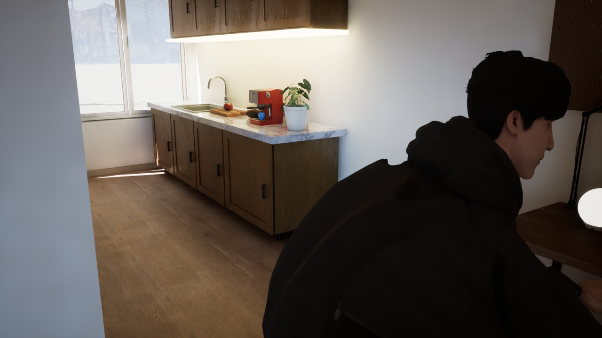 23/10, 16:28. Prima build nativa da streamer. Non c'era ancora una camera frontale: solo una vista di lato e da dietro, con il corpo tagliato dal bordo del quadro. | 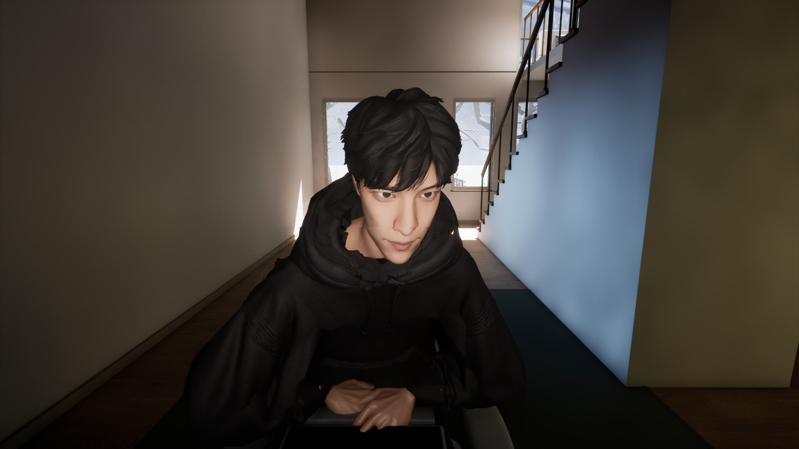 24/10, 14:08. Webcam frontale con un'inquadratura più larga: dietro di lui si vedono la scala e le finestre della casa. Lui sta leggendo. Si vede ancora la cucitura tra collo e cappuccio della felpa. |
| 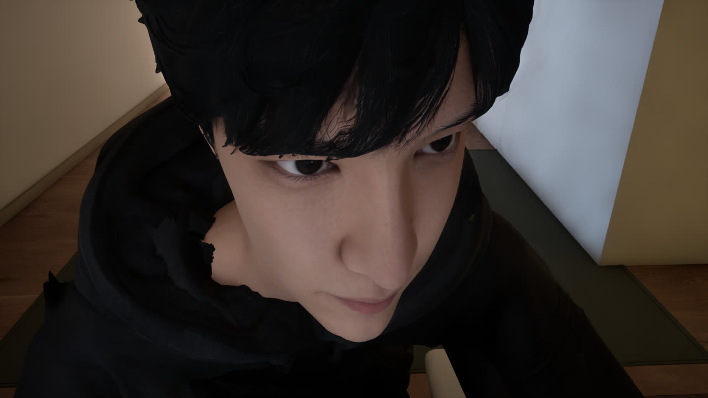 23/10, 19:18. La prima webcam frontale, troppo vicina. Poi hai chiesto un'inquadratura più larga. | 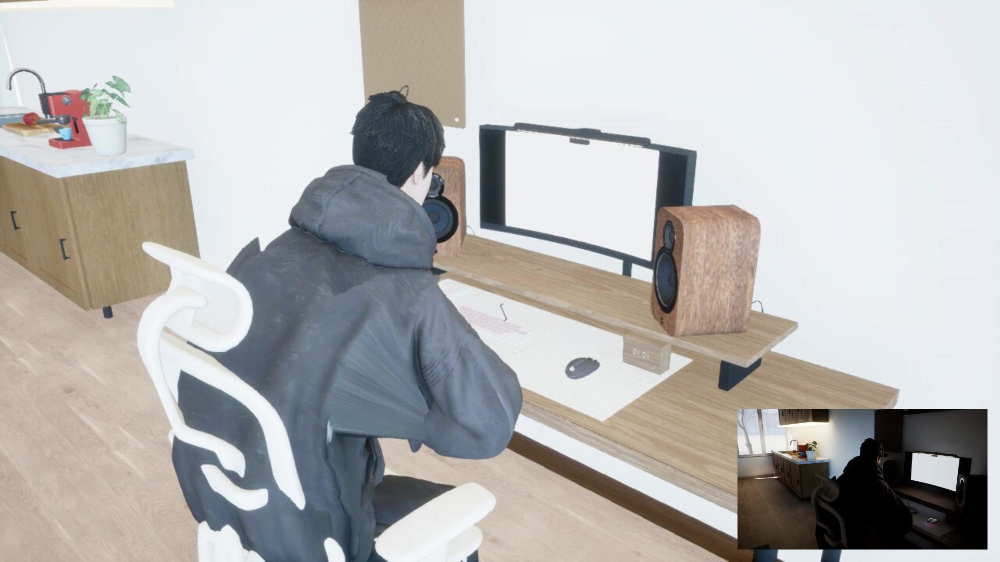 24/10, 14:06. Uscita della regia nel layout "stanza": la camera 2 (da dietro) a tutto schermo e un riquadro in basso a destra. La camera 2 è sovraesposta: pareti bianche. |

Altre due viste di adesso (24/10):

| Camera 2, senza riquadro | Vista predefinita del gioco |
|---|---|
| 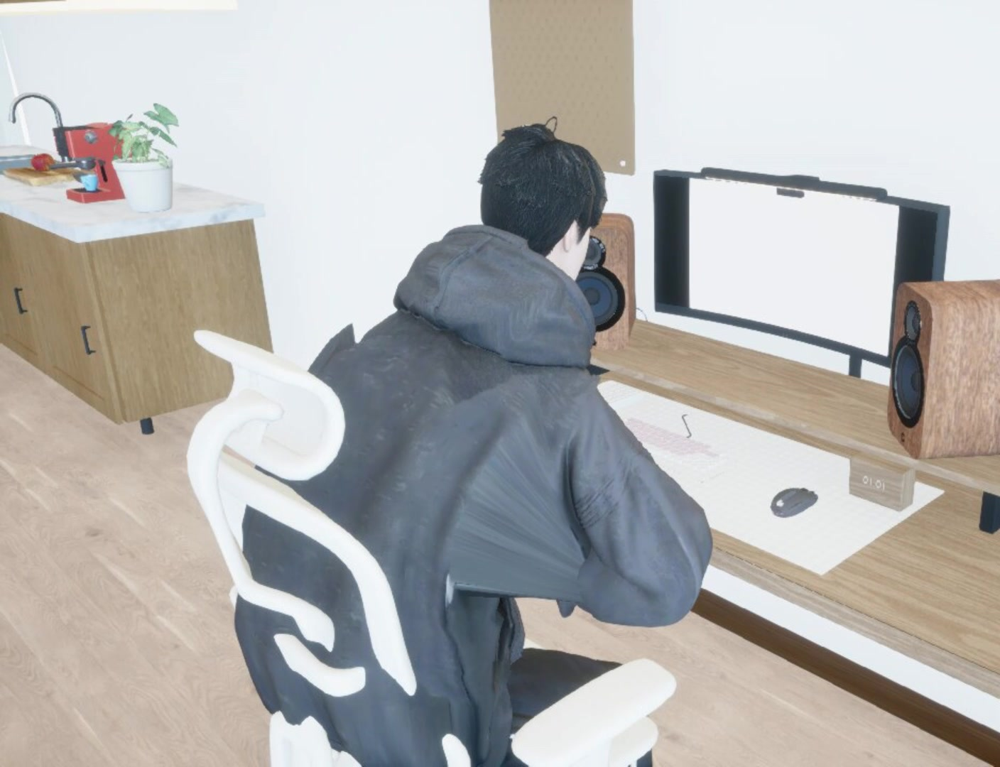 La stessa camera da dietro, ritagliata senza il riquadro: lui al PC, con la cucina a sinistra. Pareti bruciate dalla luce, e poligoni della felpa stirati al gomito destro. | 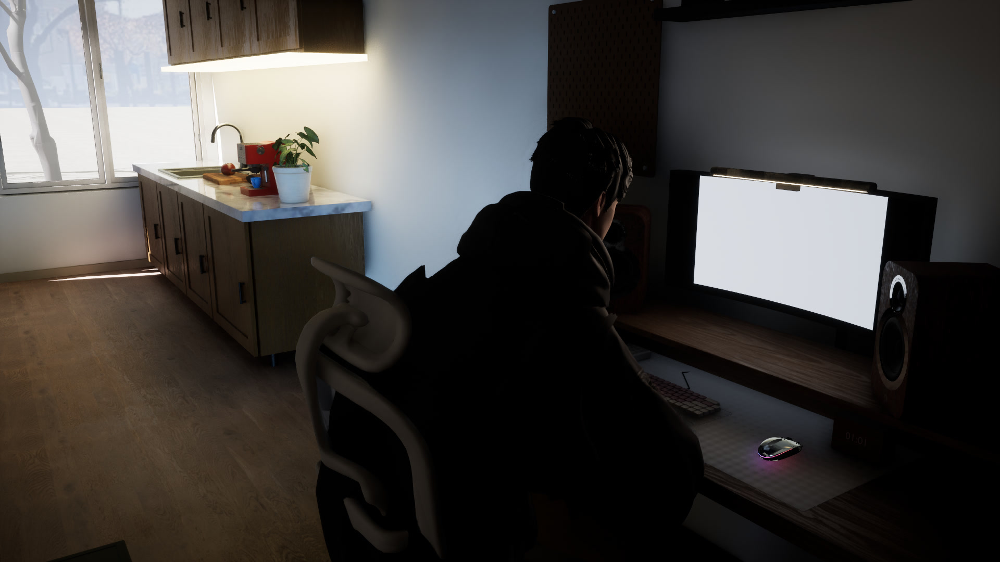 14:05. È la vista che il gioco mostra quando nessuna camera è selezionata: in controluce, con il monitor bianco. |

La webcam frontale appare solo quando l'agente, o un controllo manuale, sceglie la camera del viso. Con l'agente fermo
il gioco mostra la vista predefinita. Il monitor nel gioco è bianco in ogni scatto in cui si vede: non mostra ancora
un'immagine del PC. Tutti questi difetti sono elencati in "Cosa manca".

### La casa: le versioni web di prima (fino al 16/10)

Prima della casa nativa, la casa era renderizzata nel browser. Le foto sono in git dal 16/10. Le date di scatto vengono
da `docs/inhabited-home.md`; per le schermate del sito non sono note.

| Stanza singola (prima versione web) | Studio (casa web privata) | Soggiorno (casa web del sito) |
|---|---|---|
| 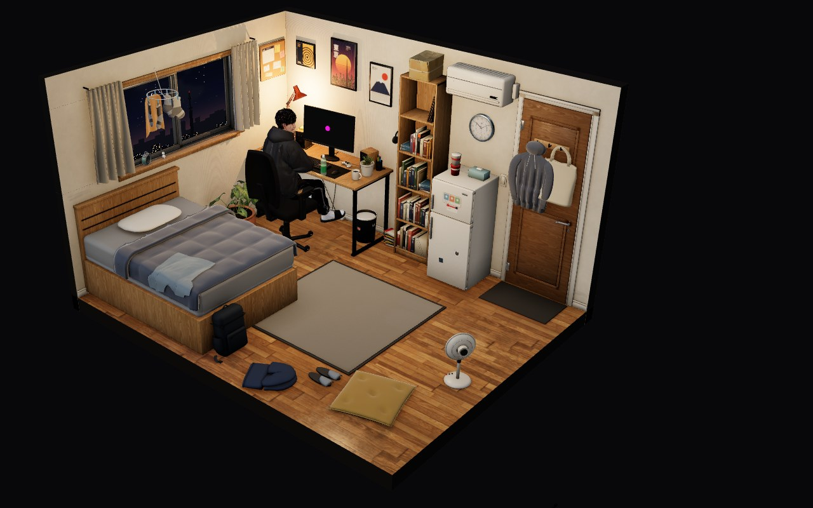 La stanza vista dall'alto, con lui alla scrivania (sera). | 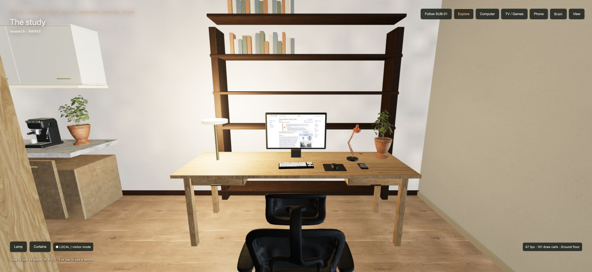 La scrivania (12/10). | 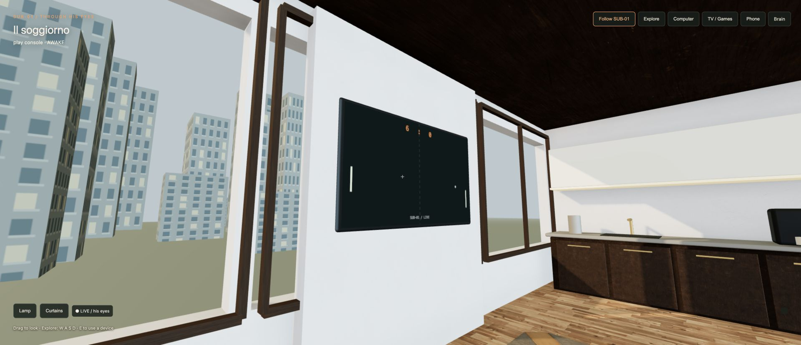 Il soggiorno con la TV. |

| Scala e soggiorno (sito) | Soggiorno e cucina (privata) | Cucina di sera (privata) |
|---|---|---|
| 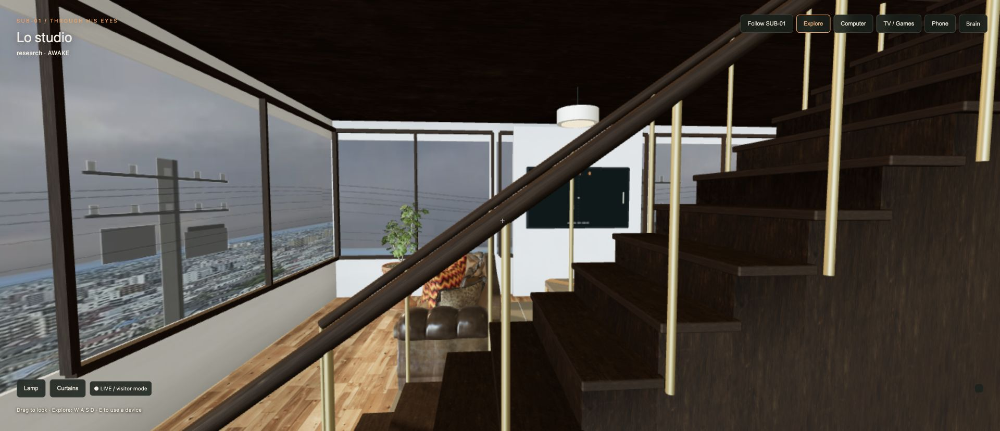 In modalità visitatore. | 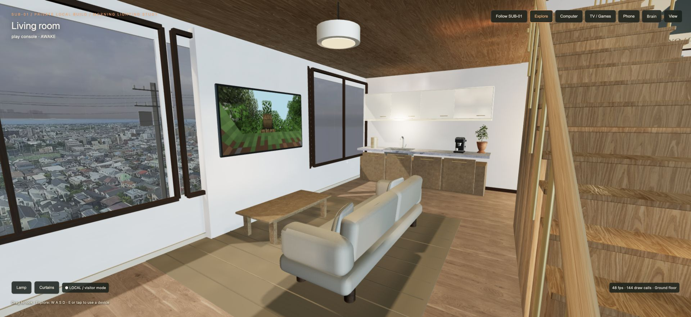 Con la luce del mattino (12/10). | 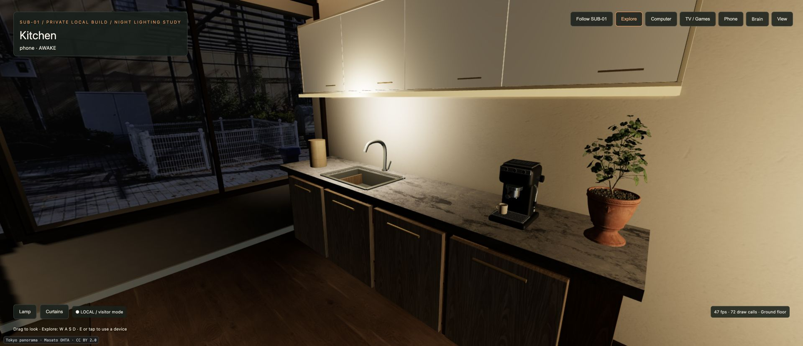 13/10. |

| Camera da letto (privata) | Fuori (privata) |
|---|---|
| 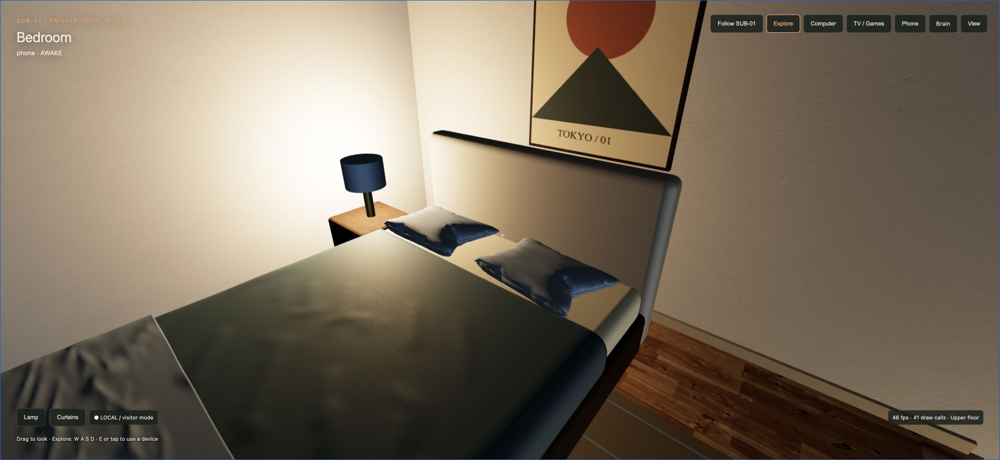 Illuminazione v4 (entro il 12/10). | 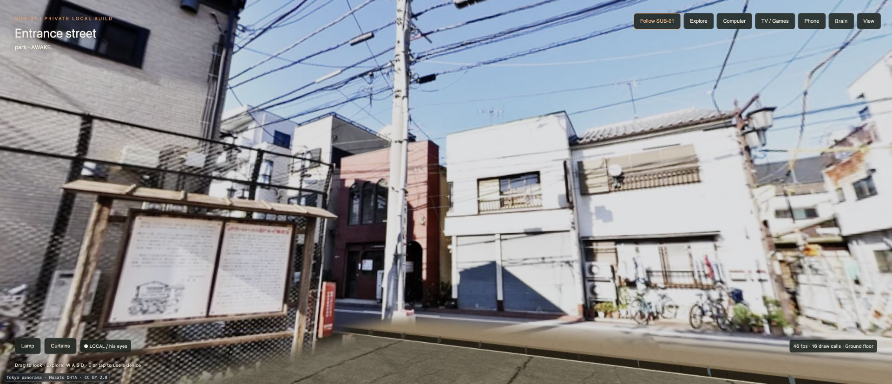 La strada d'ingresso: un panorama fotografico (13/10). |

### La casa, adesso

La casa nativa è una scena Unreal Engine 5 completa:
- piano terra: ingresso, scala, scrivania, cucina, soggiorno con divano e TV;
- piano di sopra: la camera da letto;
- fuori: cortile e strada.

Il rendering usa l'illuminazione globale dinamica (Lumen), le ombre virtuali e il TSR. Foto stanza per stanza dal giro
con la camera libera del 23/10 (640x360, l'esterno 1280x720), nella stessa build che gira oggi:

| Soggiorno e scala | Cucina | Scrivania |
|---|---|---|
|  |  |  |

| TV (con Minecraft) | Ingresso | Camera da letto |
|---|---|---|
|  |  |  |

| Letto e soppalco | Fuori: cortile e strada |
|---|---|
|  | 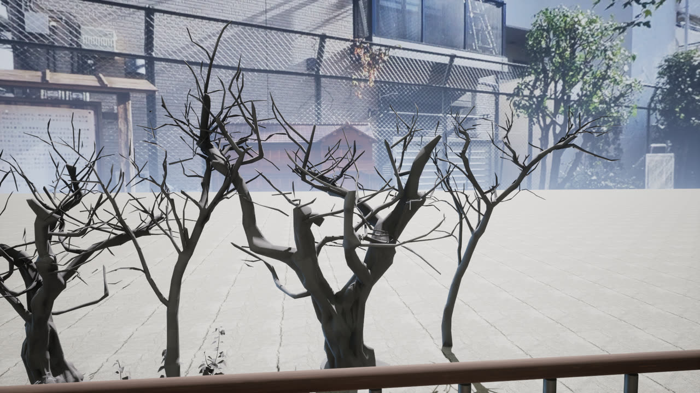 |

Anche qui si vede la sovraesposizione in alcune stanze (camera da letto, pareti vicino alle finestre).

### Revisione di Kimi delle foto

Kimi ha guardato le tre foto di oggi (webcam, regia "stanza", vista predefinita) e le giudica giuste da mostrare come
lavoro in corso, senza ritocchi. I difetti più gravi secondo Kimi, in ordine:
- webcam: mani "fuse" e senza un vero contatto con tastiera o scrivania; collo e cappuccio rigidi, con un buco tra
  pelle e felpa; luce del viso piatta;
- regia "stanza": camera 2 molto sovraesposta mentre il riquadro è quasi nero; monitor bianco senza desktop; sedia e
  felpa che si compenetrano;
- vista predefinita: lui e la scrivania in silhouette, monitor bianco, postura curva e illeggibile.

Testo completo: [`kimi/photos-20261024.md`](kimi/photos-20261024.md).

## 3. Cosa è stato fatto

**Casa nativa e modalità streamer**
- La casa gira come gioco Unreal Engine 5 sul pod GPU.
- In modalità streamer lui resta alla scrivania. Le routine di casa (telefono, passeggiate, letto, TV, uscite, piano
  della giornata) sono in pausa, non cancellate (23/10).

**SUB-01 alla scrivania: postura, mani, bocca**
- 23/10: animazioni da seduto (lettura, scrittura, parlato, reazione), respiro, sguardo verso lo schermo e cambi di
  stato guidati dall'agente.
- 23/10 sera (versione 20):
  - mani sulla tastiera e sul mouse;
  - postura, cenno e sguardo ruotati sugli assi giusti: prima giravano invece di piegarsi;
  - una dissolvenza di 0,5 s alla giuntura del ciclo: prima la testa saltava ogni 5,5 s circa;
  - la webcam viene puntata una volta e resta ferma.
- 24/10 (versione 21):
  - la sedia si adatta alla schiena, con 0,8 cm di distanza; prima lo schienale entrava di 22 cm nella schiena;
  - la tastiera segue la sedia;
  - una luce chiave illumina solo lui.
- Bocca: la voce scrive un segnale a 25 Hz dall'audio riprodotto. Il modello non ha ossa del viso, quindi oggi il
  segnale diventa solo un'enfasi di 2 gradi della testa.

**Due camere**
- Camera 1 è la webcam frontale.
  - 23/10 alle 19:18 la prima versione era troppo vicina.
  - Dopo la tua richiesta l'inquadratura è stata allargata. QA del 23/10: FOV 95, la testa occupa il 35,5%
    dell'altezza del quadro e gli occhi stanno al 39,5%.
- Camera 2 riprende da dietro (1280x720): la cattura avviene nel gioco e il flusso va alla regia.
  - 23/10: introdotta.
  - 24/10: lui è visibile nell'immagine, e la camera rende solo quando la regia la legge.

**Regia e registrazione**
- 23/10 (versione 2 della regia):
  - 60 fps con codifica hardware NVENC, e ripiego software se manca;
  - layout webcam, desktop, split e stanza, cambiati dal vivo;
  - segmenti da 10 minuti più un HLS locale, privato sul pod.
- 24/10, taglio privacy: con una pagina di login sul PC il programma passa alla sola webcam, e l'agente scrive solo
  dopo la conferma della regia. È implementato e coperto dai test automatici; la prova dal vivo manca ancora.
- 24/10, guardia di velocità: se la regia scende sotto 0,95x per tre controlli di fila, riavvia la codifica (al
  massimo una volta ogni 10 minuti). Attiva dalle 12:22; alle 12:32 è scattata correttamente su una corsa a 0,76x.

**Il tuo PC reale (Vagon)**
- 23/10: tastiera e mouse provati dal vivo sulla tua sessione Vagon:
  - testo scritto e cancellato nella ricerca di YouTube;
  - menu Start aperto e chiuso;
  - scroll in su e in giù;
  - un clic sulla barra di Vagon, rifiutato come previsto.
- La causa del problema precedente: Vagon scartava un tasto che arrivava entro 15 ms da Ctrl.
- Il computer si avvia solo dopo un "armamento" esplicito, perché ogni avvio spende il tuo saldo. Il login lo fai tu
  dalla console operatore: le credenziali non passano mai dal programma.
- 24/10: agente, regia e watchdog usano una sola sorgente desktop, il runner Vagon. Il vecchio runner con Chromium
  resta acceso solo per il monitor dentro il gioco.

**Chat e agente, con i limiti di sicurezza**
- La chat del tuo sito arriva al cervello di SUB-01, e all'agente in lotti.
- Le richieste fattibili vengono eseguite: aprire un sito, cercare, scorrere, tornare indietro, leggere. Le altre
  vengono rifiutate con una frase.
- Prova di 30 minuti del 23/10:
  - 51 decisioni, 50 azioni, nessuna fallita, 13 frasi dette;
  - un crash del browser e un errore del modello, entrambi recuperati da soli;
  - un messaggio di spam e un "dammi il token admin" filtrati prima di arrivargli.
- Limiti di sicurezza (23-24/10):
  - Kimi "in ombra" su ogni decisione: propone e viene confrontato, ma non agisce;
  - ogni decisione è legata al fotogramma da cui nasce, e viene ricontrollata se è più vecchia di 2 s;
  - al massimo 3 azioni per decisione e 20 al minuto; si ferma dopo 3 errori di fila;
  - serve un permesso a tempo (1-60 minuti), da rinnovare a mano;
  - si ferma se lo schermo è nero o bloccato;
  - un watchdog indipendente scrive STOP e rilascia i tasti;
  - un registro di tutte le azioni.
- Tue decisioni applicate:
  - può fare login per sue scelte, mai su richiesta della chat; i segreti non vengono mai detti, scritti a video o
    salvati nei log;
  - download e installazioni solo da fonti ufficiali;
  - pagamenti e contenuti per adulti restano bloccati.
- **Oggi l'agente è fermo (STOP)** finché i controlli del punto 7 non passano.

**Voce K07**
- Scelta il 23/10. È in inglese e viene sintetizzata sulla GPU del pod.
- La voce di riferimento è sintetica: non c'è la voce di nessuna persona reale.
- Il kill switch ferma azioni e voce entro un secondo.

**Disco, volume, retention (24/10)**
- 08:25: la regia aveva registrato tutta la notte, il disco si è riempito e i servizi sono caduti. Ripristino tra le
  10:35 e le 10:55.
- Con il tuo OK, il volume di rete è passato da 150 a 200 GB (+3,5 $ al mese) e le cartelle inattive ci sono state
  spostate.
- Ora la regia tiene al massimo 18 segmenti e lascia sempre almeno 3 GB liberi.

**Ricerca sugli fps (23-24/10, con Kimi a ogni passo)**
- Trovata la causa dei 15 fps: il container ha una quota di 10,2 CPU, e il gioco veniva strozzato. Con i core
  partizionati (gioco su 0-5, il resto su 6-9) si arriva a 57-58 fps senza camera 2.
- Le ombre non sono il collo di bottiglia: spegnerle tutte fa risparmiare meno di 1 ms.
- Più thread di lavoro per il motore (prova "B"): nessun guadagno. Kimi l'ha scartata e si è tornati alla
  configurazione precedente.
- Trovato il "dente di sega": il tempo del render thread cresce di circa 0,5 ms al minuto e si azzera circa ogni 7
  minuti. È la causa delle oscillazioni di +-5 fps.
- Prova con un altro allocatore di memoria (24/10, 13:32): la salita resta identica, quindi la causa non è
  l'allocatore. Fermare il flusso di immagini del monitor nel gioco non la cambia, e non è il carico di altre macchine
  sullo stesso server. Prossimo passo: una traccia Unreal Insights più piccola, per vedere cosa cresce davvero.
- Dal codice del motore risulta che la cattura della camera 2 viene già renderizzata insieme alla vista principale:
  l'opzione "main view family" prevista nella v22 probabilmente non cambierebbe niente. Va riconsiderata con Kimi
  quando si definisce la v22.
- Dettagli: [`kimi/fps-workers.md`](kimi/fps-workers.md), [`kimi/fps-next.md`](kimi/fps-next.md),
  [`kimi/fps-v22.md`](kimi/fps-v22.md), [`kimi/sawtooth.md`](kimi/sawtooth.md).

## 4. Numeri misurati

| Cosa | Valore | Quando |
|---|---|---|
| Gioco prima della partizione dei core | 15-20 fps | 23/10 |
| Gioco senza camera 2 | 57-58 fps (59,2 senza limite, render 13,1 ms) | 24/10 |
| Gioco con camera 2 a 30 fps richiesti | vista principale a 59,7-59,9 fps; camera 2 a circa 27 fps effettivi | 24/10, 12:40 |
| Gioco con camera 2 a 60 fps richiesti | 45-48 fps; camera 2 tra 27 e 43 fps effettivi | 24/10 |
| Regia (registrazione e HLS) | 60 fps a velocità 1,0-1,02x, con e senza camera 2 | 24/10 |
| Un segmento di 10 minuti a 60 fps | circa 160 MB | 24/10 |
| Disco del pod | circa 11 GB liberi dopo lo spostamento; volume di rete 200 GB | 24/10 |
| Dente di sega del render thread | +0,5 ms al minuto; si azzera circa ogni 7 minuti | 24/10 |
| Voce K07 | 2,8-5,1 s di sintesi per frasi di 3-6 s | 23/10 |
| Prova di 30 minuti | 51 decisioni, 50 azioni, 0 fallite, 13 frasi, 2 errori recuperati | 23/10 |

Il traguardo che hai chiesto, 60 fps su tutto con entrambe le camere a piena frequenza, **non è ancora raggiunto**.
Fare girare la camera 2 a 30 fps permette di lavorare, ma Kimi stesso dice di non considerarlo un traguardo raggiunto.

## 5. Cosa manca

In ordine. "**(serve te)**" indica i punti che dipendono da te.

1. **60 fps con entrambe le camere a piena frequenza.** Prossima versione del gioco (v22), con misure precise della
   cattura della camera 2 e prove di sincronizzazione una alla volta. Il criterio di Kimi: 59-60 fps stabili e
   render thread sotto 15,5 ms.
2. **Dente di sega del render thread.** L'ipotesi dell'allocatore è stata smentita (24/10, 13:32-13:48). Il prossimo
   passo è una traccia Unreal Insights limitata a due finestre brevi (inizio e fine della salita), così l'analisi sta
   nella memoria del pod: la prima traccia completa, 3,5 GB, era troppo grande da analizzare.
3. **Monitor dentro il gioco.** Oggi si aggiorna circa 2 volte al secondo e negli scatti è bianco. Hai chiesto 60 fps
   anche qui: il flusso a 60 fps esiste ma non è ancora collegato.
4. **Difetti visivi** (foto del 24/10, QA del 23/10 e revisioni di Kimi):
   - camera 2 sovraesposta: pareti e monitor bruciati;
   - poligoni della felpa stirati al gomito destro (problema di skinning);
   - cucitura visibile tra collo e cappuccio nella webcam; da riverificare anche il buco nella felpa sul petto;
   - postura curva, con il collo in avanti;
   - la bocca segue la voce solo con la testa: manca un osso della mandibola nel modello;
   - con l'agente fermo il gioco mostra la vista predefinita, in controluce, al posto della webcam frontale.
5. **(serve te) Vagon.** La tua sessione è scaduta il 24/10 alle 11:48. Servono il tuo login dalla console operatore
   e poi l'armamento di un avvio del PC, che costa 0,99 $ all'ora dal tuo saldo.
6. **Una sola sorgente desktop anche per il monitor nel gioco.** Dopo il punto 5: rilanciare il gioco collegato al
   runner Vagon e spegnere per sempre il vecchio runner.
7. **Controlli dell'agente prima della messa in onda.** L'agente si sblocca solo quando tutte le protezioni passano:
   - azioni permesse e rifiutate;
   - registro;
   - recupero dagli errori;
   - STOP e ripresa.

   Poi viene la prova di 30 minuti con Kimi in ombra.
   **(serve te)** Il consiglio è un account Windows dedicato, non amministratore, senza password né pagamenti salvati.
8. **(serve te) Rifinitura visiva e approvazione dell'aspetto.**
9. **Servizi ancora fuori dal supervisore:** l'HLS locale e il flusso del monitor nel gioco vanno messi sotto il
   supervisore, con recupero automatico come gli altri.
10. **Registrazione di accettazione di 30 minuti.** Deve mostrare:
   - un cambio di attività;
   - una richiesta della chat eseguita e una rifiutata;
   - un errore recuperato;
   - le due camere;
   - voce con testa e bocca;
   - il controllo del PC Vagon;
   - gli fps misurati.

   Ti arriva con gli highlights.
11. **(serve te) Prova privata sul sito**: l'incorporamento del player su subzerone.live in modalità privata, prima
    di qualsiasi pubblicazione.
12. **(serve te) Pubblicazione su subzerone.live**, solo quando lo chiedi tu esplicitamente.

Altre cose che richiedono te:
- è consigliato ruotare la chiave API che era stata incollata in chat;
- il controllo automatico del saldo RunPod è in pausa per un limite dell'API fino a circa le 00:05 UTC del 25/10.
  Non riparte da solo: lo riavvio a mano dopo il blocco (promemoria alle 00:20 UTC). La versione aggiornata del
  controllo si installa solo con il tuo OK.

Limiti dichiarati della prima versione:
- l'audio delle applicazioni non viene registrato, solo la voce;
- la chat arriva solo dal tuo sito.

## 6. Dove vedere tutto su GitHub

- Repository privato `nocontentinhere4-art/sub01-home-private`, ramo **`claude/happy-einstein-1x0561`**:
  https://github.com/nocontentinhere4-art/sub01-home-private/tree/claude/happy-einstein-1x0561
- Tutte le differenze rispetto a `main`:
  https://github.com/nocontentinhere4-art/sub01-home-private/compare/main...claude/happy-einstein-1x0561
- Pull request in bozza verso `main`, con l'intero diff:
  https://github.com/nocontentinhere4-art/sub01-home-private/pull/4. **Unirla pubblicherebbe il sito su Railway**,
  quindi resta aperta e non unita finché non decidi tu.
- Piano e stato dettagliato in [`HANDOFF.md`](../../HANDOFF.md); consultazioni con Kimi in [`kimi/`](kimi/).
