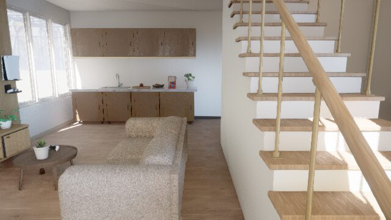
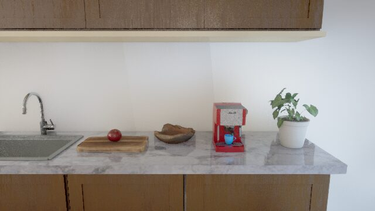
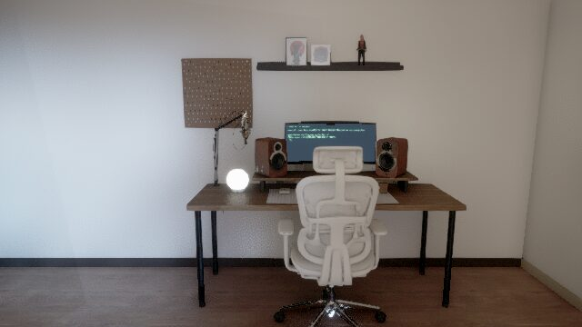
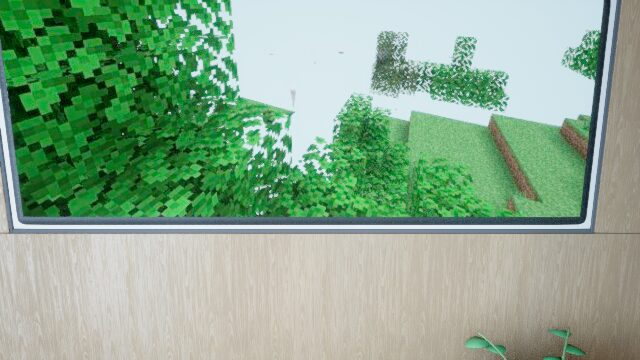
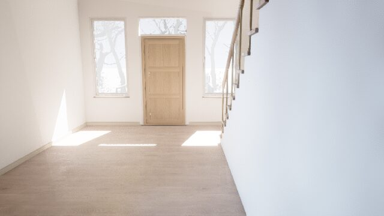
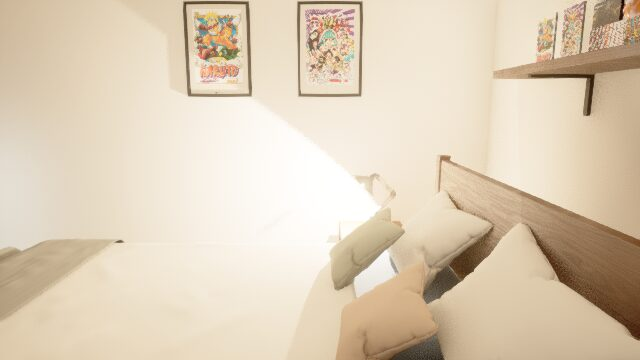
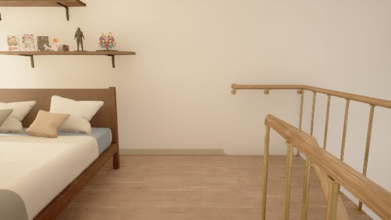

# SUB-01: project status on 2026-10-24

A page for the owner. It describes the state on 24 October 2026, early afternoon (UTC).
Sources: [`HANDOFF.md`](../../HANDOFF.md), [`REPORT-20261023.md`](REPORT-20261023.md), [`PLAN.md`](PLAN.md),
[`VISUAL-QA-20261023.md`](VISUAL-QA-20261023.md) and the consultations in [`kimi/`](kimi/).
Since 23/10 every project decision is taken together with Kimi, the project's second AI reviewer. As a rule, every
change goes through Kimi's review before the commit. More than 30 consultations are saved in `kimi/`.

## 1. Goal

SUB-01 is a simulated 20-year-old streamer who lives in a native Unreal Engine 5 house on the GPU pod. The goal is the
first complete version of the stream:
- he stays at his desk and uses your real PC (Vagon, Windows 11, Steam with Detroit: Become Human);
- he speaks English with his K07 voice and really carries out the chat's requests;
- two cameras film him at the same time at 60 fps, and the director composes and records everything, with logs,
  recovery and a kill switch.

Until you decide to go live on subzerone.live, "streaming" means a private recording and a local HLS on the pod.
**Nothing is published.** Railway deploys from the `main` branch, which has not been touched: its last commit is from
16/10.

## 2. Before and now

### SUB-01 before and now

| Before: 23/10 | Now: 24/10 |
|---|---|
|  23/10, 16:28. First native streamer build. There was no frontal camera yet: only a side and back view, with his body cut off by the frame edge. |  24/10, 14:08. Frontal webcam with a wider framing: the house's stairs and windows show behind him. He is reading. The seam between his neck and the hoodie's hood is still visible. |
|  23/10, 19:18. The first frontal webcam, too close. You then asked for a wider shot. |  24/10, 14:06. Director output in the "room" layout: camera 2 (from behind) full frame and a picture-in-picture bottom right. Camera 2 is overexposed: white walls. |

Two more views from today (24/10):

| Camera 2, without the picture-in-picture | The game's default view |
|---|---|
|  The same camera from behind, cropped without the picture-in-picture: him at the PC, the kitchen on the left. Walls blown out by the lighting, and stretched hoodie polygons at the right elbow. |  14:05. The view the game shows when no camera is selected: backlit, with a white monitor. |

The frontal webcam appears only while the agent, or a manual check, selects the face camera. With the agent held the
game shows the default view. The in-game monitor is white in every shot where it shows: it does not display a picture
of the PC yet. All these defects are listed under "What is missing".

### The house: the earlier web versions (up to 16/10)

Before the native house, the house was rendered in the browser. These photos have been in git since 16/10. Capture
dates come from `docs/inhabited-home.md`; for the site screenshots they are unknown.

| Single room (first web version) | Office (private web house) | Living room (the site's web house) |
|---|---|---|
|  The room seen from above, with him at the desk (evening). |  The desk (12/10). |  The living room with the TV. |

| Stairs and living room (site) | Living room and kitchen (private) | Kitchen at night (private) |
|---|---|---|
|  In visitor mode. |  In morning light (12/10). |  13/10. |

| Bedroom (private) | Outside (private) |
|---|---|
|  Lighting v4 (by 12/10). |  The entrance street: a photographic panorama (13/10). |

### The house now

The native house is a complete Unreal Engine 5 scene:
- ground floor: entrance, stairs, desk, kitchen, living room with sofa and TV;
- upstairs: the bedroom;
- outside: courtyard and street.

Rendering uses dynamic global illumination (Lumen), virtual shadow maps and TSR. Room-by-room photos from the 23/10
free-camera tour (640x360, the outside 1280x720), in the same build that runs today:

| Living room and stairs | Kitchen | Desk |
|---|---|---|
|  |  |  |

| TV (with Minecraft) | Entrance | Bedroom |
|---|---|---|
|  |  |  |

| Bed and loft | Outside: courtyard and street |
|---|---|
|  |  |

Overexposure shows here too in some rooms (the bedroom, walls near the windows).

### Kimi's review of the photos

Kimi reviewed today's three photos (webcam, director "room" layout, default view) and considers them acceptable to
show as unedited work in progress. The worst defects according to Kimi, in order:
- webcam: "fused" hands with no real contact with the keyboard or desk; a rigid neck and hood, with a gap between skin
  and hoodie; flat facial lighting;
- director "room" layout: camera 2 heavily overexposed while the picture-in-picture is almost black; a white monitor
  with no desktop; chair and hoodie interpenetrating;
- default view: him and the desk in silhouette, a white monitor, a hunched and unreadable posture.

Full text: [`kimi/photos-20261024.md`](kimi/photos-20261024.md).

## 3. What has been done

**Native house and streamer mode**
- The house runs as an Unreal Engine 5 game on the GPU pod.
- In streamer mode he stays at the desk. The house routines (phone, walks, bed, TV, going out, the day plan) are paused,
  not deleted (23/10).

**SUB-01 at the desk: posture, hands, mouth**
- 23/10: seated animations (reading, typing, talking, reacting), breathing, gaze towards the screen and state changes
  driven by the agent.
- 23/10 evening (version 20):
  - hands on the keyboard and the mouse;
  - posture, nod and gaze rotated on the right axes: before, they twisted instead of bending;
  - a 0.5 s crossfade at the loop seam: before, the head jumped about every 5.5 s;
  - the webcam is aimed once and then stays still.
- 24/10 (version 21):
  - the chair fits his back, with a 0.8 cm gap; before, the backrest cut 22 cm into his back;
  - the keyboard follows the chair;
  - a key light lights only him.
- Mouth: the voice writes a 25 Hz signal from the played audio. The model has no face bones, so today the signal only
  becomes a 2-degree emphasis of the head.

**Two cameras**
- Camera 1 is the frontal webcam.
  - On 23/10 at 19:18 the first version was too close.
  - After your request the framing was widened. QA of 23/10: FOV 95, the head fills 35.5% of the frame height and the
    eyes sit at 39.5%.
- Camera 2 films from behind (1280x720): it is captured in the game and the stream goes to the director.
  - 23/10: introduced.
  - 24/10: he is visible in the picture, and the camera renders only while the director reads it.

**Director and recording**
- 23/10 (director version 2):
  - 60 fps with NVENC hardware encoding, and a software fallback when it is missing;
  - webcam, desktop, split and room layouts, switched live;
  - 10-minute segments plus a local HLS, private on the pod.
- 24/10, privacy cut: with a login page on the PC the output switches to the webcam only, and the agent types only
  after the director confirms. It is implemented and covered by automated tests; the live test is still missing.
- 24/10, speed guard: if the director falls below 0.95x for three checks in a row, it restarts the encoder (at most once
  every 10 minutes). Active since 12:22; at 12:32 it fired correctly on a run at 0.76x.

**Your real PC (Vagon)**
- 23/10: keyboard and mouse tested live on your Vagon session:
  - text typed and cleared in the YouTube search;
  - Start menu opened and closed;
  - scrolling up and down;
  - a click on the Vagon bar, refused as intended.
- The cause of the earlier problem: Vagon dropped a key that arrived within 15 ms of Ctrl.
- The computer starts only after an explicit "arming", because every start spends your balance. You log in yourself
  from the operator console: the credentials never pass through the program.
- 24/10: the agent, the director and the watchdog use a single desktop source, the Vagon runner. The old Chromium
  runner stays on only for the in-game monitor.

**Chat and agent, with the safety limits**
- The chat on your site reaches SUB-01's brain, and the agent in batches.
- Feasible requests are carried out: open a site, search, scroll, go back, read. The others are refused with a
  sentence.
- 30-minute trial of 23/10:
  - 51 decisions, 50 actions, none failed, 13 sentences spoken;
  - a browser crash and a model error, both recovered on their own;
  - a spam message and a "give me the admin token" filtered before reaching him.
- Safety limits (23-24/10):
  - Kimi "in shadow" on every decision: it proposes and is compared, but does not act;
  - every decision is bound to the frame it comes from, and is re-checked if older than 2 s;
  - at most 3 actions per decision and 20 per minute; it stops after 3 errors in a row;
  - a timed permit (1-60 minutes) is required and is renewed by hand;
  - it stops if the screen is black or frozen;
  - an independent watchdog writes STOP and releases the keys;
  - a log of every action.
- Your decisions, applied:
  - he may log in by his own choice, never at the chat's request; secrets are never spoken, shown on screen or saved
    in the logs;
  - downloads and installs only from official sources;
  - payments and adult content stay blocked.
- **Today the agent is held (STOP)** until the checks of item 7 pass.

**K07 voice**
- Chosen on 23/10. It speaks English and is synthesised on the pod's GPU.
- The reference voice is synthetic: no real person's voice is used.
- The kill switch stops actions and voice within one second.

**Disk, volume, retention (24/10)**
- 08:25: the director had recorded all night, the disk filled up and the services went down. Recovered between 10:35
  and 10:55.
- With your OK, the network volume went from 150 to 200 GB (+$3.5 per month) and the idle folders were moved there.
- The director now keeps at most 18 segments and always leaves at least 3 GB free.

**Frame-rate research (23-24/10, with Kimi at every step)**
- Found the cause of the 15 fps: the container has a quota of 10.2 CPUs, and the game was throttled. With the cores
  partitioned (the game on 0-5, the rest on 6-9) it reaches 57-58 fps without camera 2.
- Shadows are not the bottleneck: turning them all off saves less than 1 ms.
- More engine worker threads (trial "B"): no gain. Kimi rejected it and the previous configuration is back.
- Found the "sawtooth": the render thread time grows by about 0.5 ms per minute and resets about every 7 minutes. It is
  the cause of the +-5 fps swings.
- Trial with another memory allocator (24/10, 13:32): the ramp is identical, so the allocator is not the cause.
  Stopping the in-game monitor's image feed does not change it, and it is not the load of other machines on the same
  server. Next step: a smaller Unreal Insights trace, to see what really grows.
- The engine source shows that camera 2's capture is already rendered together with the main view: the "main view
  family" option planned for v22 would probably change nothing. To be reconsidered with Kimi when v22 is scoped.
- Details: [`kimi/fps-workers.md`](kimi/fps-workers.md), [`kimi/fps-next.md`](kimi/fps-next.md),
  [`kimi/fps-v22.md`](kimi/fps-v22.md), [`kimi/sawtooth.md`](kimi/sawtooth.md).

## 4. Measured numbers

| What | Value | When |
|---|---|---|
| Game before the core partition | 15-20 fps | 23/10 |
| Game without camera 2 | 57-58 fps (59.2 uncapped, render 13.1 ms) | 24/10 |
| Game with camera 2 at 30 fps requested | main view at 59.7-59.9 fps; camera 2 at about 27 fps achieved | 24/10, 12:40 |
| Game with camera 2 at 60 fps requested | 45-48 fps; camera 2 between 27 and 43 fps achieved | 24/10 |
| Director (recording and HLS) | 60 fps at 1.0-1.02x speed, with and without camera 2 | 24/10 |
| One 10-minute segment at 60 fps | about 160 MB | 24/10 |
| Pod disk | about 11 GB free after the move; 200 GB network volume | 24/10 |
| Render-thread sawtooth | +0.5 ms per minute; resets about every 7 minutes | 24/10 |
| K07 voice | 2.8-5.1 s of synthesis for 3-6 s sentences | 23/10 |
| 30-minute trial | 51 decisions, 50 actions, 0 failed, 13 sentences, 2 errors recovered | 23/10 |

The target you asked for, 60 fps on everything with both cameras at full rate, **is not reached yet**. Running camera 2
at 30 fps lets the work go on, but Kimi also says this does not meet the target.

## 5. What is missing

In order. "**(needs you)**" marks the items that depend on you.

1. **60 fps with both cameras at full rate.** Next game version (v22), with precise measurements of camera 2's capture
   and synchronisation trials one at a time. Kimi's criterion: a steady 59-60 fps and the render thread under 15.5 ms.
2. **Render-thread sawtooth.** The allocator hypothesis was falsified (24/10, 13:32-13:48). The next step is an Unreal
   Insights trace limited to two short windows (start and end of the ramp), so the analysis fits in the pod's memory:
   the first full trace, 3.5 GB, was too big to analyse.
3. **In-game monitor.** Today it updates about twice a second and shows white in the shots. You asked for 60 fps here
   too: the 60 fps feed exists but is not connected yet.
4. **Visual defects** (photos of 24/10, QA of 23/10 and Kimi's reviews):
   - camera 2 overexposed: walls and monitor burnt out;
   - stretched hoodie polygons at the right elbow (a skinning problem);
   - a visible seam between neck and hood in the webcam; the hole in the hoodie on the chest is to be re-checked too;
   - a hunched posture, with the neck forward;
   - the mouth follows the voice only through the head: the model has no jaw bone;
   - with the agent held, the game shows the backlit default view instead of the frontal webcam.
5. **(needs you) Vagon.** Your session expired on 24/10 at 11:48. It needs your login from the operator console and then
   the arming of a PC start, which costs $0.99 per hour from your balance.
6. **A single desktop source for the in-game monitor too.** After item 5: relaunch the game connected to the Vagon
   runner and switch the old runner off for good.
7. **Agent checks before going on air.** The agent is released only when every protection passes:
   - allowed and refused actions;
   - the log;
   - recovery from errors;
   - STOP and resume.

   Then comes the 30-minute trial with Kimi in shadow.
   **(needs you)** The advice is a dedicated, non-administrator Windows account with no saved passwords or payments.
8. **(needs you) Visual polish and your approval of the look.**
9. **Services not yet under the supervisor:** the local HLS and the in-game monitor feed must go under the supervisor,
   with automatic recovery like the others.
10. **30-minute acceptance recording.** It must show:
    - a change of activity;
    - one chat request carried out and one refused;
    - a recovered error;
    - both cameras;
    - voice with head and mouth;
    - control of the Vagon PC;
    - the measured fps.

    It reaches you with the highlights.
11. **(needs you) Private test on the site**: embedding the player on subzerone.live in private mode, before any
    publication.
12. **(needs you) Publication on subzerone.live**, only when you explicitly ask for it.

Other things that need you:
- rotating the API key that was pasted in the chat is advised;
- the automatic RunPod balance check is paused because of an API limit until about 00:05 UTC on 25/10. It does not
  restart by itself: I resume it by hand after the block (reminder at 00:20 UTC). The updated version of the check is
  installed only with your OK.

Declared limits of the first version:
- the applications' audio is not recorded, only the voice;
- the chat comes only from your site.

## 6. Where to see everything on GitHub

- Repository `nocontentinhere4-art/sub01-home-private` (currently **public**: anyone can read it), branch
  **`claude/happy-einstein-1x0561`**:
  https://github.com/nocontentinhere4-art/sub01-home-private/tree/claude/happy-einstein-1x0561
- Every difference from `main`:
  https://github.com/nocontentinhere4-art/sub01-home-private/compare/main...claude/happy-einstein-1x0561
- Draft pull request towards `main`, with the whole diff:
  https://github.com/nocontentinhere4-art/sub01-home-private/pull/4. **Merging it would publish the site on Railway**,
  so it stays open and unmerged until you decide.
- The detailed plan and state are in [`HANDOFF.md`](../../HANDOFF.md); the Kimi consultations are in [`kimi/`](kimi/).
