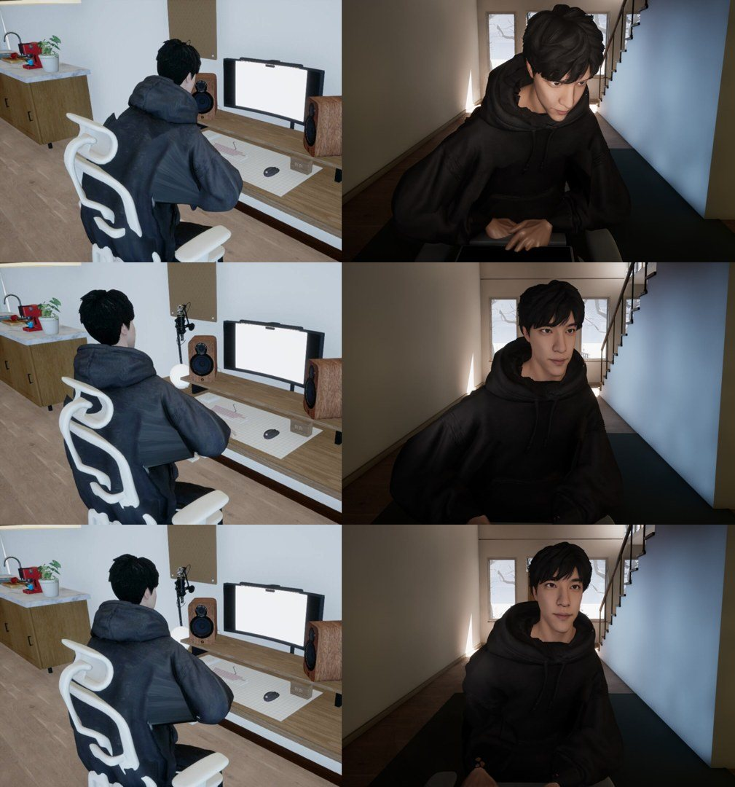

# Visual tuning on v23 (2026-10-24, 19:20-20:00 UTC)

Native build v23 (`tools/native_streamer_visual_v2/install_v23.py`) made every look correction a live key in the
private tuning file. This is the first live session: one game process (plain m3 launcher on the v23 binaries), keys set
with `/home/unreal/tune.py`, frames from `/tmp/sub01-share/frames.sh` (webcam = the game window on `:99`, cam2 = the
director's `room` layout from the local HLS), measurements from the v23 receipt. Three frame reviews with Kimi:
`docs/streamer/kimi/visual-tuning-20261024.md`.

**Result: approved by Kimi as the still-frame checkpoint, then signed off for the visible fixed-webcam motion (scope below).** Values:
`docs/streamer/tuning/streamer-visual-tuning-20261024-p5.json` (on the pod: `/tmp/sub01-share/tune/checkpoint-p5.json`).

Rows: before (v23 defaults, typing) / after, typing / after, reading. Left cam2, right the frontal webcam (cropped).

## What changed

| | Before (t0) | After (p5 typing / p6r reading) |
|---|---|---|
| Torso incline (receipt) | 22 deg | 8.3 / 8.6 deg |
| Head ahead of the shoulders | 3.3 cm | 0.5 / 0.8 cm |
| Fingertips vs key tops | -3.4 / -9.1 cm (left / right) | +0.3 / -0.3 cm |
| Stretched hoodie "fan" on cam2 | large, right side | gone while reading; a faint stretch at the right mid-back while typing |
| Neck / hood seam on the webcam | jagged skin gap | much smaller |
| Face light | flat | key moved 55 cm to the side, 10 cm up, plus a soft fill |

## Values (changed from the v23 defaults)

`hand_back_cm=12 hand_height_cm=9.5 elbow_min_deg=100 elbow_pole_back=1.0 elbow_pole_out=0 pelvis_pitch_deg=-6
typing_lean_deg=-4 posture_lean_deg=-10 shoulder_drop_deg=3 shoulder_back_deg=2 neck_back_deg=5 hand_orient=1
hand_yaw_in_deg=12 hand_pitch_deg=10 finger_bend_deg=8 finger_curl_deg=0 key_side_cm=-55 key_up_extra_cm=10
fill_cd=0.01 fill_side_cm=45 fill_up_cm=0 fill_temp_k=5000 chair_back_extra_cm=2`

Rollback: set each key back to its v23 default (README, v23 table) or restore the tuning file saved before the session
(`/tmp/sub01-share/tune/checkpoint-p2.json` is the intermediate one).

## Findings

- **The fan is a skinning defect of the main body mesh.** Hiding material slot 1 (`PortableOriginalHoodiePalette_KnitRight`)
  hides the whole hoodie body, arms and legs (`photos/20261024-tuning/diag-hide-slot-7-vs-1.jpg`), so the stretched sheet
  belongs to it; slot 7 changes nothing visible. Elbow pole and minimum-angle keys alone did not change it
  (`diag-elbow-tests.jpg`). What removed it was the posture: an upright torso (pelvis and lean keys) with the wrists
  brought back toward the hips. A real fix needs re-weighting the hoodie in the asset (not possible live).
- **The hands type on a keyboard tray at lap height** that follows the chair (since v21), not on the desk keyboard.
- **The white sphere** left of the speaker in cam2 is a globe desk lamp (it stays with the fill light off).
- Raising the hands by 4.5 cm straightened the torso by ~13 deg (typing incline 10.8 -> -2 deg); `typing_lean_deg`
  -10 -> -4 brought it back to 8.3 deg.

## Kimi's caveats (to record)

- Contact tolerance, not clearance: one hand is 3 mm below the key-top level.
- Still frames only. Still to check in motion (typing -> reading -> typing at 60 fps): no key or chair penetration,
  stable IK and elbows, smooth posture and head transitions without popping, a clean return to the typing pose; also
  fingers skating or hovering, rigid block-like hands, torso/neck/head moving as one piece, frozen gaze, periodic
  breathing.
- Not done yet: chair cosmetics beyond the 2 cm back offset, rim light (Kimi: none for now), `neck_share` only as an
  A/B if the seam shows in motion, the mouse (`mouse_scan`, `hand_on_mouse`).

## Motion check (round 4)

18 s of the frontal webcam at 30 fps, typing (6 s) -> reading (6 s) -> typing (7 s):
`photos/20261024-tuning/motion-sheet-typing-reading-typing.jpg` (1 frame per second) and
`photos/20261024-tuning/motion-switch-reading-to-typing.jpg` (the four frames around the largest change).

- Body-crop frame differences (mean abs luma, 0-255): median 0.57, p95 1.89, max 4.54 at the reading -> typing switch
  (~11.1 s). The background does not move: the webcam keeps its aim across states.
- The switch is the compiled 0.24 s clip crossfade plus the lean change -10 deg (reading) -> -4 deg (typing); at the
  12 deg/s posture ease the full lean travel takes ~0.5 s.
- Kimi: no visible pop, IK flip or penetration; the ~0.2 s adjustment is acceptable; keep -10 / -4; mild residual
  stiffness (little secondary motion, block-like upper body). **Sign-off for the fixed-webcam motion of checkpoint p5.**
- Not certified: hand IK and key contact in motion, geometry outside the crop, full-rate motion outside the switch. A
  longer crossfade, if full-speed playback shows an abrupt onset, needs a build (the crossfade is compiled).
